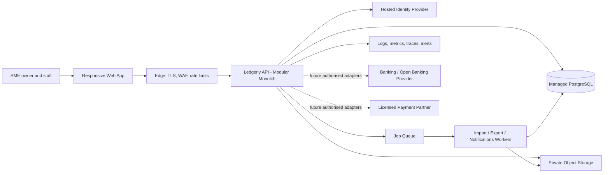
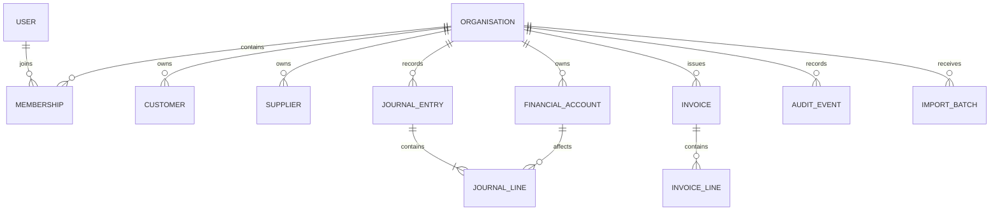
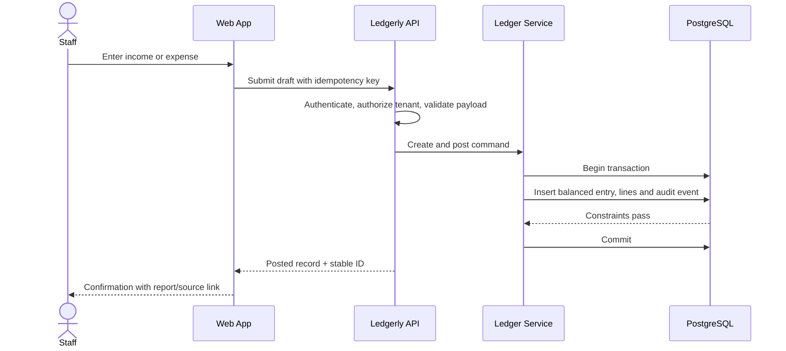

# Ledgerly — System Architecture and Technical Design

**Stage:** 2 — Architecture and technical design  
**Status:** Proposed; decisions requiring validation are explicitly marked  
**Product:** Nigeria-first financial management SaaS for SMEs  
**Date:** 5 November 2026

## 1. Purpose and source of truth

This document defines a practical architecture for an MVP that helps Nigerian small and medium-sized businesses understand and manage their finances, with a path to expand based on customer feedback. It is not an implementation plan and does not authorize coding.

The referenced Work conversation confirms the vision—help owners understand where money comes from, where it goes, and make better business decisions—and identifies Financial X-Ray, What-If Simulator, Financial Early Warning, financial management, operations, analytics, AI assistance and administration as candidate product pillars. However, the actual completed PRD text was not present in the retrieved conversation; its detailed requirements and role matrix therefore cannot be verified here. This design uses the confirmed scope as its basis and marks the resulting assumptions for reconciliation against the PRD before UI/UX.

This product is a financial recordkeeping and insight tool. It does not hold customer funds, issue stored value, execute transfers, initiate payments, provide lending, or represent itself as a bank or payment provider. Any such capability requires a separate product and licensing/partner review.

## 2. Architecture principles

1. **MVP first, modular monolith:** one deployable API and one relational database with clear domain boundaries. Avoid microservices until scale, team ownership or isolation needs justify them.
2. **Authoritative records:** financial entries are append-only once posted; corrections use reversal and replacement, not destructive edits.
3. **Tenant isolation by construction:** every business-owned record carries an organisation boundary and authorization is enforced server-side on every request.
4. **Explainable numbers:** reports and insight cards must drill back to source records and disclose data freshness, completeness and assumptions.
5. **Graceful low-connectivity use:** responsive web UI, resumable imports and clear pending/saved states. Offline writes are out of MVP unless the PRD requires them.
6. **Secure defaults and minimum collection:** collect only data needed for bookkeeping and product operation; avoid bank credentials and unnecessary identity data.
7. **Provider-neutral seams:** integrations sit behind adapters; Ledgerly’s core domain does not depend on a single bank, payment provider or cloud vendor.
8. **Progressive sophistication:** begin with manual entry, CSV and deterministic calculations; add automation and AI only when customer value, consent, data quality and review controls are established.

## 3. MVP boundary

### In scope (proposed)
- Organisation setup, membership and invitation; owner/admin and staff access.
- Manual income/expense records, categories, customers/suppliers and invoice tracking if confirmed by PRD.
- CSV import with preview, mapping, validation, duplicate detection and an import log.
- Dashboard summaries, basic reports and export, with source drill-down.
- Audit trail for consequential actions and a supportable account/data export process.
- Financial X-Ray expressed initially as transparent summaries/rules, not opaque AI.

### Explicitly deferred
- Native mobile applications; launch with responsive web/PWA assessment only.
- Bank feeds, payment initiation, payment custody, card issuing, wallet, lending or money movement.
- Automated tax filing, statutory accounting certification or guaranteed tax advice.
- Multi-currency consolidation, multi-entity consolidation, inventory/ payroll, branch-level controls unless PRD confirms priority.
- AI assistant, predictive early warning and What-If Simulator beyond clearly labelled static/manual scenarios; future features need data quality and explainability gates.
- Microservices, event streaming, data warehouse and active-active multi-region architecture.

**MVP release gate:** validate the exact MVP feature list and user-role matrix against the completed PRD before screen design.

## 4. Recommended technology and hosting

A vendor-neutral default is proposed; these are recommendations, not established PRD decisions.

| Layer | MVP recommendation | Reason / choice to validate |
|---|---|---|
| Web frontend | TypeScript + React, server-rendered framework (e.g. Next.js); responsive browser app | Mature ecosystem, accessible component options, shared types; select framework based on team skills |
| Mobile | No separate native app in MVP; responsive web/PWA candidate | Reduces parallel delivery and support cost; validate mobile-first usage and offline needs |
| Backend | TypeScript API in a modular monolith (e.g. NestJS or framework-native server routes); REST/JSON | Clear modules, validation and predictable integration surface; choose one framework, not both |
| Database | Managed PostgreSQL; relational constraints, transactions, reporting and row-level security as defense-in-depth | Strong fit for bookkeeping and tenant-scoped relationships |
| Files | Private object storage for import files/exports, short-lived signed access, malware scanning where available | Keep large files outside relational database; retention and residency to validate |
| Jobs | Managed queue for imports, exports, email and scheduled summaries; idempotent workers | Keep slow tasks out of web requests; can start with managed queue or database-backed jobs |
| Identity | Hosted OIDC identity provider with MFA support, verified email, secure session cookies | Avoid custom password/security stack; provider, Nigerian availability and data processing terms to assess |
| Hosting | Managed container/app platform in a region selected after latency, residency, vendor and cost review; managed Postgres and backups | Do not assume a Nigeria cloud region or a specific provider without verification |
| Delivery | Git-based CI/CD, infrastructure as code, automated schema migrations, staged releases and rollback | Reproducible environments and controlled changes |

**Region decision:** choose hosting region after confirming Nigerian data-protection transfer requirements, customer commitments, provider subprocessors, recovery objectives, latency and total cost. “Nigeria-first” does not by itself prove that every record must be physically hosted in Nigeria; counsel and privacy assessment must establish the actual obligations.

## 5. Logical architecture

MVP requests flow through the web app, edge controls and one API. The API validates identity, organisation membership, permission and input before a domain service writes to PostgreSQL. Imports and reports too large for a synchronous request use a queue and worker. External financial providers are not connected in MVP.

### Runtime boundaries
- **Presentation:** UI state, form validation for usability, accessibility and API client. No financial authority in browser calculations.
- **API/application:** authentication context, tenant authorization, input validation, use-case orchestration and response shaping.
- **Domain:** money/value rules, posting/reversal, invoice state and report calculations. No framework or provider dependencies.
- **Persistence/integration:** repositories, database transaction boundaries, queue, object storage and future provider adapters.

## 6. Multi-tenant organisation model

A person may belong to multiple organisations. Organisation is the business tenant; branches/departments are optional sub-scopes only if the PRD requires them. MVP records are tenant-scoped by `organisation_id`.

**Isolation controls:**
- Resolve active organisation from a server-validated membership, not a client-supplied organisation ID alone.
- Include `organisation_id` in every tenant table, lookup, unique constraint and index where appropriate.
- Use composite foreign keys such as `(organisation_id, customer_id)` so cross-tenant references cannot be stored accidentally.
- Apply PostgreSQL row-level security as a second barrier if operationally practical; API authorization remains mandatory.
- Add tests for cross-tenant read/write denial during implementation and security review.
- Database maintenance/admin paths must be explicit, audited and unavailable to ordinary tenant users.

## 7. Authentication and authorization

Use OIDC authorization-code flow with PKCE, secure, HTTP-only, same-site cookies for browser sessions, CSRF protection on state-changing browser requests, short-lived sessions and revocation on logout/security events. Enforce MFA for privileged/support access and offer or require it for organisation owners based on usability assessment. Never store identity-provider passwords.

**Provisional roles** (must reconcile with PRD):
- **Owner:** organisation settings, membership, all financial data, exports and deletion requests.
- **Admin:** day-to-day configuration and membership; sensitive ownership/billing actions may remain owner-only.
- **Finance manager:** create, review, post/reverse records, invoices and reports.
- **Staff/contributor:** create permitted drafts and view only permitted areas.
- **Read-only/adviser:** view and export only when explicitly granted.
- **Platform support:** no routine content access; time-bound, purpose-limited, approved and audited break-glass access only.

Authorization combines role permissions with organisation membership and resource ownership. Deny by default. Check permission in the application service for every command and query, and record who acted, under which organisation, and the outcome for sensitive actions. Decide whether fine-grained data visibility or branch scope is needed before UI/UX.

## 8. Core domain modules and boundaries

| Module | Owns | Must not own |
|---|---|---|
| Identity & Membership | User profile reference, invitations, membership, roles | Financial records or identity provider credentials |
| Organisation | Business profile, base currency, fiscal settings, optional branch | User authentication |
| Ledger | Accounts/categories, journal entries/lines, posting/reversal, balances | Bank balances claimed as live unless sourced and timestamped |
| Receivables / Invoicing | Customers, invoices, line items, due dates, status, recorded payments | Payment execution or custody |
| Payables / Expenses | Suppliers, expense records, evidence attachment references | Lending or supplier settlement |
| Imports | Upload batches, mapping, validation errors, dedupe keys and row-level decisions | Directly bypassing domain validation |
| Reporting & Insights | Read models and deterministic summaries with source references | Mutating source transactions or unexplained recommendations |
| Audit | Append-only security/business event metadata | Replacing domain records as the source of truth |
| Notifications | Templates, delivery attempts and preferences | Sensitive financial payloads in email/SMS by default |

Modules may share a database in MVP but write through owned application services. Cross-module changes use explicit transactions or queued events; avoid arbitrary table writes across module boundaries.

## 9. Financial model, entities and integrity

High-level entities: `User`, `Organisation`, `Membership`, optional `Branch`, `FinancialAccount`, `Category`, `Customer`, `Supplier`, `Invoice`, `InvoiceLine`, `JournalEntry`, `JournalLine`, `Attachment`, `ImportBatch`, `ImportRow`, `AuditEvent`, `IdempotencyRecord`.

For trustworthy balances, prefer a double-entry ledger internally even if the UI calls entries income/expense. Each posted journal entry balances debits and credits in one currency. The PRD may describe simpler records; reconcile the data model with those workflows before design. A journal line stores account, debit/credit amount, currency and optional customer/supplier/invoice/category references. Keep money in integer minor units (kobo) or a carefully specified fixed-precision decimal; never binary floating point. Currency exponent and rounding policy are explicit. Nigeria MVP defaults to NGN; foreign currency remains disabled until conversion, rate sourcing and revaluation behavior are defined.

**Lifecycle:** draft → validated → posted → reversed (with a linked correcting entry). Posted entries cannot be edited or deleted through ordinary flows. Voids before posting may be cancelled with an audit event. Invoice status is derived or transitioned under explicit rules; payment records are bookkeeping facts, not actual transfer instructions.

**Atomic posting transaction:** validate organisation ownership, account state, currency, balanced totals and period rules; insert entry and lines; update derived balance/read models or mark them for rebuild; append audit event; commit together. Use database constraints for non-negative amounts, valid debit/credit side, tenant-aware references and unique external/import keys. Use idempotency keys for retries. Reports should be reproducible from posted entries and state their “as of” time.

### Financial data flow

CSV import follows the same domain path: upload to private storage, parse and preview, map columns, validate and deduplicate, show errors, then commit accepted rows through normal services. Import must never silently overwrite posted records.

## 10. API design conventions

Use versioned REST/JSON (`/api/v1`), OpenAPI contract, consistent ISO-8601 UTC timestamps, opaque stable IDs, explicit currency codes and integer minor amounts. Paginate list endpoints with cursor pagination; support filters and stable sort. Use standard error shape with machine code, human message, field details and correlation ID. Validate input on server; reject unknown sensitive fields. Require idempotency keys on create/import/post operations. Use ETags or version numbers for concurrent edits to drafts. Never expose internal database IDs or stack traces.

Representative groups (illustrative, not final contracts):
- `GET/POST /api/v1/organisations`; `GET/PATCH /api/v1/organisations/{id}`
- `GET/POST /api/v1/organisations/{id}/members`; `PATCH .../members/{membershipId}`
- `GET/POST /api/v1/organisations/{id}/transactions`; `GET .../transactions/{id}`; `POST .../transactions/{id}/post`; `POST .../transactions/{id}/reverse`
- `GET/POST /api/v1/organisations/{id}/invoices`; `POST .../invoices/{id}/record-payment` (records a fact only)
- `POST /api/v1/organisations/{id}/imports`; `GET .../imports/{batchId}`; `POST .../imports/{batchId}/commit`
- `GET /api/v1/organisations/{id}/reports/{reportType}`
- `GET /api/v1/organisations/{id}/audit-events` (permission-controlled)

Avoid endpoints that imply a live bank balance or payment initiation unless a future authorised integration is enabled and clearly attributed to its provider.

## 11. Audit, privacy and security

Audit events should capture actor or system identity, tenant, action, resource type/ID, timestamp, request/correlation ID, outcome, and before/after hashes or safe field-level diff where appropriate. Exclude passwords, access tokens, full bank credentials, and unnecessary personal data. Protect events from alteration using restrictive database roles, append-only write paths and periodic immutable export/retention controls. Define retention and data-subject request handling with counsel.

Security baseline: TLS in transit; managed encryption at rest; secrets manager; least-privilege service/database roles; MFA for privileged accounts; rate limiting and abuse controls; secure headers; input validation; dependency and container scanning in CI; vulnerability response; redacted logs; signed private file access; short-lived tokens; key rotation; backup encryption; admin access logging; secure deletion of expired files. Complete threat modelling and independent security review before production handling of real financial data.

Privacy design: document purposes and lawful bases, controller/processor roles, data inventory, retention, user rights workflows, subprocessors, cross-border transfers, breach escalation and privacy notices. Do not use customer financial records to train general models. Future AI features require explicit purpose/consent analysis, minimised context, provider terms review, tenant isolation, output disclaimers and human verification.

## 12. Integrations strategy

**MVP:** manual entry and CSV only. Provide documented templates, column mapping, locale/date/decimal handling, preview, row errors, duplicate detection and rollback of an uncommitted batch. Preserve original file reference and import provenance under retention limits.

**Future:** use adapter interfaces for bank statement data, authorised open banking, accounting/tax and payment-provider status. Integrate only with user consent, scoped tokens, clear revocation, provider provenance and reconciliation. Prefer read-only data aggregation first. Payment services, if ever offered, must be provided by an appropriately authorised partner or by a separately licensed Ledgerly entity, with counsel confirming the product boundary. Do not collect or store online banking passwords.

## 13. Reliability, observability, backup and recovery

Instrument structured logs with request ID, tenant-safe pseudonymous identifiers, route, duration and result; metrics for availability, latency, error rate, queue age, import failures, database saturation and backup age; distributed traces across API and workers. Alert on customer-impacting symptoms and failed recovery controls. Avoid high-cardinality personal/financial values in telemetry.

Use automated encrypted database backups and point-in-time recovery, plus separate object-storage versioning/backup for essential uploaded evidence. Run scheduled restore drills and record evidence. Initial proposed targets for product owner approval: RPO ≤ 24 hours and RTO ≤ 8 hours for MVP; tighten only where business impact justifies cost. Backups must be access-controlled and retention/expiry tested. A backup is not considered proven until restored and validated.

## 14. Scalability and cost

Start with one stateless API deployment, one managed PostgreSQL primary, connection pooling, indexed tenant-scoped queries and asynchronous jobs for heavy workloads. Add read replicas or materialized views only when query patterns require them. Partition very large append-only ledger/audit tables only after observed growth; keep tenant predicates and indexes aligned. Scale app instances horizontally before decomposing services. Establish per-tenant quotas, file size limits and report windows to protect shared capacity.

Track unit costs: active organisations, database storage/IO, file storage/egress, identity MAU, queue volume, email/SMS, logs and support. Minimise always-on components. Avoid multi-region writes, bespoke analytics warehouse and high-volume event streaming in MVP. Cost thresholds and expected pilot volumes are unresolved inputs.

## 15. Nigeria-specific questions for qualified counsel and compliance experts

These are validation questions, not legal conclusions:
- Does the exact functionality and marketing remain outside CBN-regulated payment activity? Would any account aggregation, payment initiation, collection or settlement flow require a licensed partner or approval? Review current CBN payment-service and open-banking instruments. [CBN Payment Service Providers](https://www.cbn.gov.ng/PaymentsSystem/PSPs.html), [CBN Operational Guidelines for Open Banking](https://www.cbn.gov.ng/Out/2023/CCD/Operational%20Guidelines%20for%20Open%20Banking%20in%20Nigeria.pdf)
- Under the Nigeria Data Protection Act 2023, what controller/processor duties, lawful basis, DPIA, DPO/DPCO, breach, retention and cross-border-transfer requirements apply to Ledgerly and each provider? [NDPC NDP Act 2023](https://www.ndpc.gov.ng/ndp-act-2023/)
- What accounting, tax, e-invoicing/fiscalisation, record-retention and export requirements apply to Ledgerly’s invoice and report features, especially as Nigerian tax administration evolves? Confirm directly with tax counsel and relevant authorities before promising compliance. [FIRS e-invoicing service](https://atrs.firs.gov.ng/)
- Do product workflows create AML/CFT, KYC, consumer-protection or outsourcing obligations even when Ledgerly does not custody funds?
- What contractual, data-location, subprocessor disclosure and incident-notification commitments are appropriate for target SMEs and financial partners?
- Are there sector-specific obligations for customers (e.g. financial services, health, public sector) that need exclusion or separate controls?

Regulatory references can change; obtain current advice at launch and whenever product scope changes.

## 16. Deployment environments and operations

- **Local development:** synthetic/test data only; isolated configuration and disposable database.
- **Development/shared integration:** non-production provider credentials and test tenants; no production PII.
- **Staging:** production-like configuration, masked/synthetic data, release candidate smoke checks and restore/runbook rehearsal.
- **Production:** isolated accounts/projects, restricted operator access, secrets manager, monitored backups, change approval and rollback plan.

Use separate secrets and databases per environment. Schema changes should be backward-compatible where practical: expand, deploy, migrate data, then contract. Feature flags control staged rollout. Keep deployment artifacts immutable and attributable to a source revision. Document incident response, access review, backup restoration, tenant export/deletion and vendor outage runbooks.

## 17. Key technical risks and decisions

| Decision / risk | Proposed direction | Validation needed before UI/UX or build |
|---|---|---|
| Actual PRD detail unavailable in retrieved chat | Treat this document as provisional architecture | Reconcile modules, MVP requirements, roles and acceptance criteria against original PRD |
| Ledger complexity vs basic cashbook | Double-entry internals with approachable UI | Confirm accounting model and target user literacy with product/accounting adviser |
| Hosting/data residency | Managed cloud selected after legal/vendor review | Confirm transfer basis, region, subprocessor and customer promise |
| Identity provider | Hosted OIDC | Assess cost, availability, data handling, MFA and account recovery |
| Mobile/offline | Responsive web first | Validate device mix, network conditions and offline expectation |
| Invoice/payment wording | Recordkeeping only | Define copy and interaction boundaries to avoid implying payment execution |
| Tax/report compliance | General management reporting only | Counsel/accountant defines required disclaimers, formats and future compliance scope |
| Insights/AI | Explainable deterministic rules first | Validate definitions, thresholds, data sufficiency and human review |
| Branch/multi-currency | Defer unless PRD mandates | Confirm launch segment needs and migration implications |
| Recovery targets | Initial RPO 24h / RTO 8h proposal | Product owner accepts business impact and cost |
| Import correctness | Preview, validation, dedupe, staged commit | Define supported bank/export formats and duplicate policy |

## 18. Assumptions and unresolved decisions

**Assumptions:** initial operation is Nigeria-focused; NGN is default currency; first client is a responsive web app; manual entry and CSV are the initial sources; customers need bookkeeping visibility and management insights; a managed relational database is affordable; no regulated movement of funds is part of the MVP.

**Unresolved:** detailed PRD contents and MVP acceptance criteria; exact transaction model; invoice and debt workflows; accounting expertise/support model; mobile/offline requirements; branch and multi-currency priorities; identity and cloud vendor/region; data retention and recovery targets; target pilot scale; pricing and support service levels; which insights qualify as the differentiator at launch.

## 19. Technical readiness checklist for UI/UX stage

- [ ] Obtain the completed PRD text and reconcile all assumptions, MVP boundaries, user stories and acceptance criteria.
- [ ] Approve the launch persona set and role/permission matrix, including membership invitation and recovery flows.
- [ ] Confirm the MVP finance vocabulary and lifecycle: draft, post, correct/reverse, invoice and recorded payment.
- [ ] Confirm NGN/kobo display, rounding, date/time conventions, fiscal-year setup and CSV locale handling.
- [ ] Decide whether branches, multi-currency, attachments, reports, exports and invoice tracking are in launch scope.
- [ ] Define low-connectivity behavior, mobile breakpoints and accessible interaction requirements.
- [ ] Agree the data freshness/completeness labels and source drill-down required for every dashboard or insight.
- [ ] Approve the non-payment product boundary and language for invoices, balances and payment records.
- [ ] Identify privacy notice/consent touchpoints and sensitive-data minimisation rules for design.
- [ ] Define empty, loading, validation, import-error, permission-denied, retry and destructive-action states.
- [ ] Confirm audit-visible actions, owner-only actions and any export/deletion workflows.
- [ ] Review this architecture with product, accounting, security and qualified Nigerian legal/privacy advisers before implementation.

**Architecture stage outcome:** a proposed, reviewable system design is ready to inform UI/UX once the actual PRD is reconciled and the checklist’s product decisions are resolved. No code or repository has been created.
